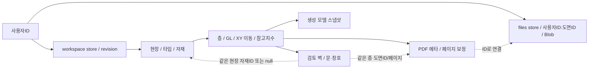

# 브라우저 작업공간 저장 관계

상태: 로컬 브라우저 구현 — 원격 SQL DB 대상 아님 (2026-11-18)

사전 검토: 현재 원격 ERD에 테이블 없음 확인. 참조 대상/부모/삭제 범위/nullable/중복/저장실패를 설계와 대조했고 원격 FK 변경 문제 없음. 아래는 SQL FK ERD가 아닌 IndexedDB aggregate 관계다.

- `workspace`와 `files`의 쓰기는 같은 readwrite transaction. 사용자별 aggregate revision 불일치 시 abort.
- 층 삭제: 도면·검토·모델 이력과 도면 Blob 함께 제거. 도면 삭제: 연결 검토 벽 제거, 이전 스냅샷은 보존. 자재 삭제: 현재 검토 연결 해제. 모델 삭제: PDF/검토 유지.
- 기존84A localStorage와 원본 PDF는 변경하지 않음. 원격 저장/RLS/SQL 적용은 하지 않았다.
